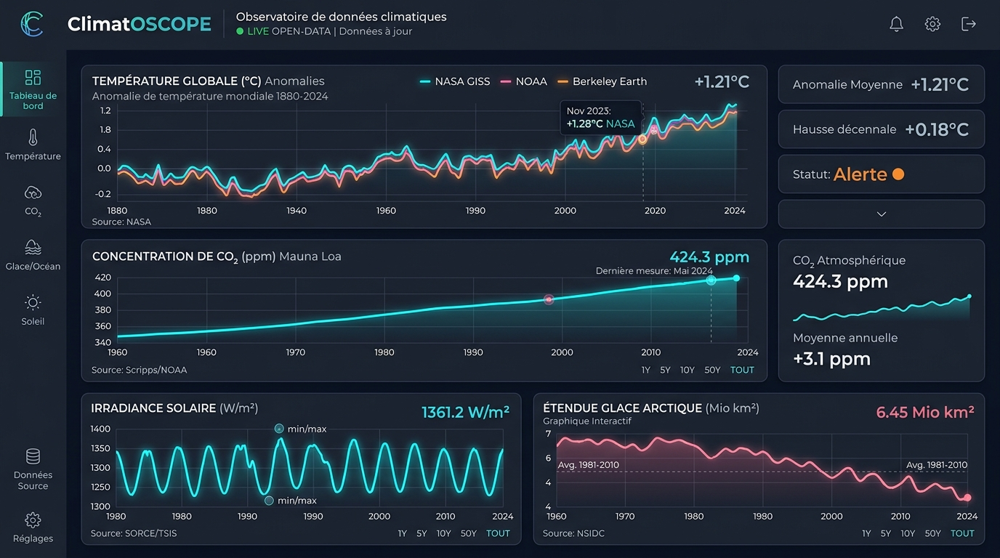

<div align="center">

  

  # 🌍 ClimatOSCOPE
  
  ### *Comprendre le climat à partir des mesures physiques directes*
  
  **Observatoire scientifique open-data · Séries temporelles d'organismes de recherche internationaux · Architecture Progressive Web App (PWA) Offline-First**

  [](https://github.com)
  [](https://pages.cloudflare.com)
  [](https://web.dev/progressive-web-apps/)
  [](https://vitest.dev)
  [](LICENSE)

  <br />

  

  <br />
  <em>Vue du tableau de bord multi-indicateurs avec navigation catégorisée, thèmes Sombre/Clair et traçabilité scientifique de bout en bout.</em>

</div>

---

## 📌 Sommaire

- [✨ Points Forts & Fonctionnalités](#-points-forts--fonctionnalités)
- [📱 Installation de l'Application (PWA)](#-installation-de-lapplication-pwa)
- [⚙️ Paramètres Système & Mises à Jour Automatiques](#️-paramètres-système--mises-à-jour-automatiques)
- [🌓 Mode Sombre & Ergonomie Visuelle](#-mode-sombre--ergonomie-visuelle)
- [🧭 Onboarding Légal & Guides Contextuels](#-onboarding-légal--guides-contextuels)
- [🔬 Catalogue des Modules Scientifiques](#-catalogue-des-modules-scientifiques)
- [☁️ Déploiement Optimisé Cloudflare Pages](#️-déploiement-optimisé-cloudflare-pages)
- [💻 Développement & Commandes](#-développement--commandes)
- [⚖️ Clause de Non-Responsabilité](#️-clause-de-non-responsabilité)

---

## ✨ Points Forts & Fonctionnalités

ClimatOSCOPE est conçu pour offrir aux citoyens, étudiants, ingénieurs et chercheurs une interface transparente, rigoureuse et sans filtre partisan :

| Pilier | Description |
| :--- | :--- |
| **Zéro Donnée Fictive** | 100% des séries proviennent de dépôts publics vérifiables (NASA, NOAA, Berkeley Earth, LASP, SILSO, ECMWF). |
| **Menu Hamburger Catégorisé** | Tiroir latéral structuré en 6 catégories claires pour naviguer aisément entre les 14 modules. |
| **Mises à Jour en Arrière-Plan** | Système autonome de détection et rafraîchissement régulier des versions et données en cache. |
| **PWA Installable en 1 Clic** | Bouton universel « Installer l'application » pour mobile (iOS/Android) et desktop (Chrome, Edge, macOS, Windows). |
| **Thème Sombre Observatoire** | Interface soignée haute lisibilité avec bascule instantanée vers un thème clair. |
| **Épistémologie & Garde-fous** | Distinction stricte entre corrélation mathématique et causalité physique démontrée. |
| **Offline-First & Résilience** | Cache local persistant via **IndexedDB** et Service Worker (Workbox). Aucune coupure réseau ne bloque l'analyse. |

---

## 📱 Installation de l'Application (PWA)

ClimatOSCOPE est une **Progressive Web App (PWA)** certifiée. Elle peut être installée comme une application native sans passer par les stores d'applications :

* 🖥️ **Sur Ordinateur (Chrome, Edge, Brave, Safari) :** Cliquez sur le bouton bleu **« Installer l'app »** situé dans l'en-tête ou dans le menu Hamburger. Une boîte de dialogue du navigateur vous invitera à ajouter l'application à votre bureau.
* 📱 **Sur Mobile Android :** Le bouton déclenche l'invite native d'installation pour créer une icône autonome sur l'écran d'accueil avec affichage plein écran.
* 🍏 **Sur iPhone / iPad (Safari iOS) :** Cliquez sur le bouton d'installation pour ouvrir le guide pas-à-pas interactif (*Bouton Partager* <kbd>⎙</kbd> → *Sur l'écran d'accueil* <kbd>＋</kbd>).

---

## ⚙️ Paramètres Système & Mises à Jour Automatiques

Accessible depuis l'icône <kbd>⚙️</kbd> de l'en-tête ou le menu Hamburger, le panneau **Paramètres Système** comprend :

1. **Date de Sortie Officielle :** Horodatage certifié de la version déployée (`20 octobre 2026`).
2. **Date de la Dernière Vérification :** Horodatage exact de la dernière interrogation du serveur.
3. **Bouton « Vérifier les mises à jour » :** Lance une interrogation immédiate du Service Worker et de la signature applicative.
4. **Bouton « Forcer la mise à jour » :** Purge instantanément tous les caches (Service Worker, CacheStorage, IndexedDB) et recharge la dernière version propre.
5. **Worker Automatique en Arrière-Plan :** Vérifie automatiquement la disponibilité de nouvelles versions :
   - Toutes les 30 minutes de manière transparente ;
   - Dès que l'onglet redevient actif après une mise en veille ;
   - Dès que l'appareil retrouve sa connexion réseau.

---

## 🌓 Mode Sombre & Ergonomie Visuelle

L'application propose deux ambiances chromatiques adaptées à tous les environnements :
- **Thème Sombre (par défaut) :** Palette spatiale basée sur *Slate 950*, optimisée pour les écrans OLED, réduisant la fatigue visuelle lors de l'étude prolongée des graphiques.
- **Thème Clair :** Palette claire et contrastée conçue pour les projections en salle de cours ou les impressions.
- Changement instantané avec synchronisation `localStorage` et mise à jour de la balise HTML `meta name="theme-color"`.

---

## 🧭 Onboarding Légal & Guides Contextuels

- **Onboarding de Bienvenue :** À la première ouverture (ou via le bouton *Mentions Légales*), une modale explicite rappelle la neutralité de l'outil et détaille la provenance des données.
- **Clause de Non-Responsabilité :** L'éditeur décline formellement toute responsabilité légale quant à l'exactitude, l'exhaustivité ou l'usage fait des données scientifiques fournies.
- **Guides Contextuels Déroulants sur Chaque Écran :** Chaque module dispose d'un bandeau pédagogique repliable détaillant :
  - *Ce que mesure cet écran* ;
  - *Source officielle & Méthode de calcul* ;
  - *Clé d'interprétation physique*.
- **Infobulles Interactives (`?`) :** Présentes à côté de chaque champ, filtre de profondeur, curseur d'éruption ou sélecteur géographique pour expliquer leur signification.

---

## 🔬 Catalogue des Modules Scientifiques

```
┌────────────────────────────────────────────────────────────────────────┐
│                          CATÉGORIES DU MENU                            │
├──────────────────────────┬─────────────────────────────────────────────┤
│ 1. Vue d'ensemble        │ 📊 Observatoire Général Multi-Indicateurs   │
│ 2. Climat & Températures │ 🌡️ Température Globale (GISS, NOAA, Berkeley)│
│                          │ 🌎 Réanalyses ERA5 & Amplification Polaire  │
│ 3. Gaz à Effet de Serre  │ 🧪 Mauna Loa CO₂ & Scripps Keeling Curve    │
│                          │ 💨 Méthane (CH₄), Protoxyde (N₂O) & AGGI    │
│                          │ ☁️ Aérosols Troposphériques CAMS & Twomey   │
│ 4. Cycles Naturels       │ ☀️ Irradiance Solaire LISIRD (TSI) & SILSO  │
│                          │ 🌋 Volcanisme & Forçage Stratosphérique SAOD│
│ 5. Océans & Glaces       │ 🌊 Contenu Thermique OHC (Argo 0-2000m)     │
│                          │ 🧊 Banquise Arctique & Antarctique (NSIDC)  │
│                          │ 🌐 Bilan Radiatif CERES au Sommet (TOA)     │
│ 6. Outils & Méthode      │ ☀️ Climatologie Locale Solaire NASA POWER   │
│                          │ ⚖️ Comparateur Multi-Séries & Corrélation    │
│                          │ 📚 Registre des Sources & Cache IndexedDB   │
│                          │ ❓ Guide Épistémologique « Comment Lire ? » │
└──────────────────────────┴─────────────────────────────────────────────┘
```

---

## ☁️ Déploiement Optimisé Cloudflare Pages

Le projet est conçu pour être déployé sur **Cloudflare Pages** :

* **Zéro fichier `bun.lock` :** Utilisation stricte de standard `npm` et `package-lock.json` pour éviter tout échec de build sur l'environnement Cloudflare.
* **Routage SPA :** Fichier `public/_redirects` configuré pour rediriger toutes les routes vers `index.html` (`/*  /index.html  200`).
* **Politique d'en-têtes HTTP (`public/_headers`) :**
  - Cache immuable de 1 an sur les assets statiques avec hash (`/assets/*`).
  - Cache désactivé (`max-age=0, no-cache`) sur `sw.js` et `manifest.webmanifest` pour garantir l'installation immédiate des mises à jour.
  - En-têtes de sécurité : `X-Content-Type-Options: nosniff`, `X-Frame-Options: SAMEORIGIN`, `Referrer-Policy: strict-origin-when-cross-origin`.

---

## 💻 Développement & Commandes

```bash
# 1. Cloner et installer les dépendances standard
npm install

# 2. Lancer le serveur de développement (port 3000)
npm run dev

# 3. Exécuter la suite de tests automatisés (27 tests)
npm test

# 4. Vérifier la conformité TypeScript
npm run lint

# 5. Compiler pour la production (sortie dist/)
npm run build
```

---

## ⚖️ Clause de Non-Responsabilité

> **Avertissement :** L’éditeur et les contributeurs de l'application ClimatOSCOPE déclinent formellement toute responsabilité quant à l’exactitude, l'exhaustivité, l’actualité ou l’adéquation à un usage particulier des données, calculs, graphiques et séries temporelles présentés. L'application est fournie « en l'état », à des fins purement éducatives et informatives. Les données officielles restent la propriété exclusive des organismes émetteurs respectifs (NASA, NOAA, ECMWF, SILSO, LASP, NSIDC).

---

<div align="center">
  <sub>ClimatOSCOPE · Conçu pour l'accès universel et transparent aux données climatiques ouvertes · 2026</sub>
</div>
